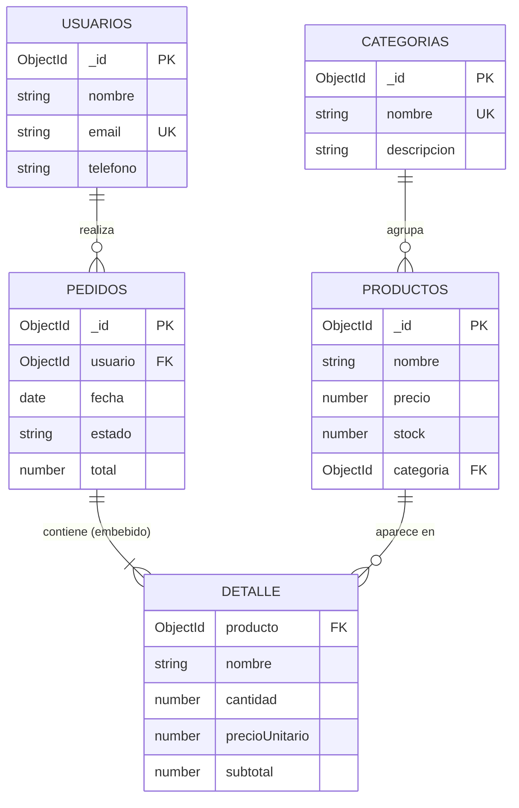
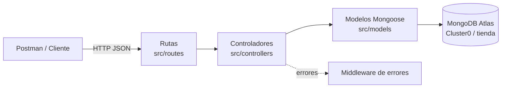

# Base de datos – Colecciones y diagrama

Base de datos: **MongoDB Atlas** · cluster `Cluster0` · base `tienda`.
En MongoDB las "tablas" se llaman **colecciones** y cada registro es un **documento**.

Las colecciones están ordenadas según sus dependencias: primero las que no dependen de ninguna.

| Orden | Colección    | Depende de                         |
|------:|--------------|------------------------------------|
| 1     | `usuarios`   | —                                  |
| 2     | `categorias` | —                                  |
| 3     | `productos`  | `categorias`                       |
| 4     | `pedidos`    | `usuarios`, `productos` (detalles) |

---

## 1. usuarios

| Campo     | Tipo     | Restricciones                     |
|-----------|----------|-----------------------------------|
| _id       | ObjectId | **PK**, generado por MongoDB      |
| nombre    | String   | obligatorio, máx. 100             |
| email     | String   | obligatorio, **único**, formato email |
| telefono  | String   | opcional, máx. 20                 |
| createdAt | Date     | automático                        |
| updatedAt | Date     | automático                        |

## 2. categorias

| Campo       | Tipo     | Restricciones                |
|-------------|----------|------------------------------|
| _id         | ObjectId | **PK**                       |
| nombre      | String   | obligatorio, **único**, máx. 80 |
| descripcion | String   | opcional                     |
| createdAt   | Date     | automático                   |
| updatedAt   | Date     | automático                   |

## 3. productos

| Campo     | Tipo     | Restricciones                        |
|-----------|----------|--------------------------------------|
| _id       | ObjectId | **PK**                               |
| nombre    | String   | obligatorio, máx. 120                |
| precio    | Number   | obligatorio, ≥ 0                     |
| stock     | Number   | obligatorio, ≥ 0, por defecto 0      |
| categoria | ObjectId | **FK → categorias._id**, obligatorio |
| createdAt | Date     | automático                           |
| updatedAt | Date     | automático                           |

## 4. pedidos

| Campo     | Tipo              | Restricciones                                    |
|-----------|-------------------|--------------------------------------------------|
| _id       | ObjectId          | **PK**                                           |
| usuario   | ObjectId          | **FK → usuarios._id**, obligatorio               |
| fecha     | Date              | por defecto la fecha actual                      |
| estado    | String (enum)     | `pendiente` · `pagado` · `enviado` · `cancelado` |
| detalles  | Array\<Detalle\>  | al menos 1 elemento (documentos embebidos)       |
| total     | Number            | se calcula automáticamente                       |
| createdAt | Date              | automático                                       |
| updatedAt | Date              | automático                                       |

### 4.1 Detalle (embebido dentro de `pedidos.detalles`)

| Campo          | Tipo     | Restricciones                               |
|----------------|----------|---------------------------------------------|
| producto       | ObjectId | **FK → productos._id**                      |
| nombre         | String   | nombre del producto al momento de comprar   |
| cantidad       | Number   | ≥ 1                                         |
| precioUnitario | Number   | precio al momento de comprar                |
| subtotal       | Number   | cantidad × precioUnitario                   |

> En SQL esto sería una tabla aparte (`detalle_pedidos`). En MongoDB se guarda **dentro** del pedido, porque siempre se lee junto con él.

---

## Relaciones

| Relación                     | Tipo  | Cómo se guarda                               |
|------------------------------|-------|----------------------------------------------|
| categorias → productos       | 1 : N | referencia `productos.categoria`             |
| usuarios → pedidos           | 1 : N | referencia `pedidos.usuario`                 |
| pedidos → detalles           | 1 : N | array embebido `pedidos.detalles`            |
| productos → detalles         | 1 : N | referencia `pedidos.detalles.producto`       |
| pedidos ↔ productos          | N : M | resuelta con los detalles embebidos          |

Reglas al eliminar: no se puede borrar una categoría con productos, un usuario con pedidos, ni un producto que esté en algún pedido (responde 409).

---

## Diagrama entidad–relación

> Se ve como diagrama en GitHub, o en VS Code con la extensión *Markdown Preview Mermaid Support*.
> También se puede pegar en https://mermaid.live



## Arquitectura (MVC con Mongoose)



## Ejemplo de documento `pedidos`

```json
{
  "_id": "6720f1c2a1b2c3d4e5f60789",
  "usuario": "6720f0a1a1b2c3d4e5f60001",
  "fecha": "2026-10-26T14:00:00.000Z",
  "estado": "pendiente",
  "detalles": [
    { "producto": "6720f0b2a1b2c3d4e5f60011", "nombre": "Mouse inalámbrico", "cantidad": 2, "precioUnitario": 45000, "subtotal": 90000 }
  ],
  "total": 90000
}
```
